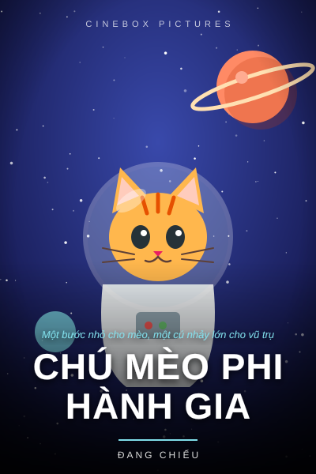
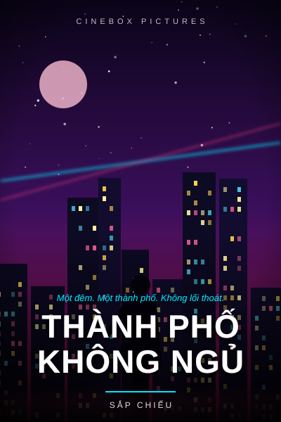
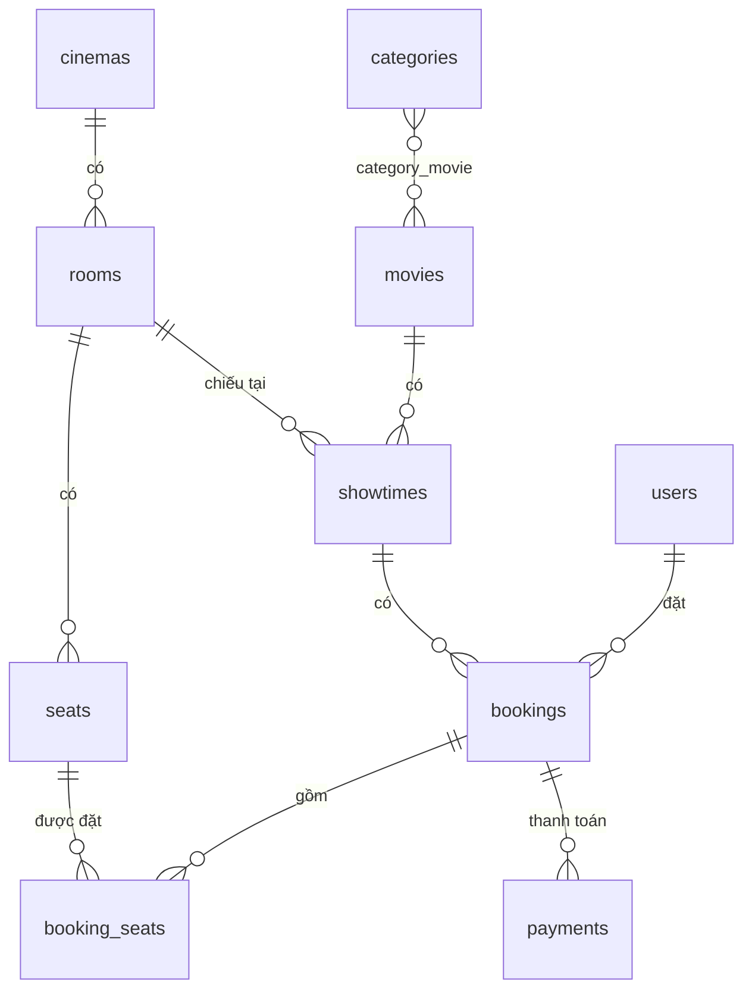

<h1 align="center">🎬 CineBox: Website đặt vé xem phim</h1>

<p align="center">
  Đồ án website đặt vé xem phim trực tuyến xây dựng bằng <b>Laravel 12</b>, giao diện <b>Blade + Bootstrap 5</b>,
  cơ sở dữ liệu <b>PostgreSQL trên Supabase</b> (hoặc SQLite để chạy thử).
</p>

<p align="center">
  
  
  
  
  
  
</p>

<p align="center">
  <a href="https://codespaces.new/Hanny2005/CineBox?quickstart=1"></a>
</p>

<p align="center">
  
  
  
  
</p>

## 🚀 Chạy nhanh

| Cách | Làm gì |
|---|---|
| **Chạy ngay trên trình duyệt** (không cần cài gì) | Bấm nút **Open in GitHub Codespaces** ở trên → đợi khoảng 2–3 phút → website tự mở ở cổng 8000. Cần đăng nhập GitHub (tài khoản free có giờ dùng miễn phí mỗi tháng). |
| **Windows** | `git clone https://github.com/Hanny2005/CineBox.git` → mở thư mục `CineBox` → bấm đúp **`setup.bat`** |
| **macOS / Linux** | `git clone https://github.com/Hanny2005/CineBox.git && cd CineBox && ./setup.sh` |

Script tự làm hết: cài thư viện, tạo `.env`, tạo database SQLite kèm dữ liệu mẫu, rồi mở website.
Đăng nhập bằng `admin@cinema.test` / `password`, hoặc bấm **"Dùng tài khoản mẫu"** ở trang đăng nhập.

## Mục lục
- [Tính năng](#tính-năng)
- [Công nghệ](#công-nghệ)
- [Chạy nhanh](#-chạy-nhanh)
- [Cài đặt và chạy](#cài-đặt-và-chạy)
- [Kết nối Supabase](#kết-nối-supabase)
- [Tài khoản mẫu](#tài-khoản-mẫu)
- [Thiết kế cơ sở dữ liệu](#thiết-kế-cơ-sở-dữ-liệu)
- [Cấu trúc thư mục](#cấu-trúc-thư-mục)
- [Hướng phát triển](#hướng-phát-triển)
- [Skill cho AI agent](#skill-cho-ai-agent)

## Tính năng

### 👤 Khách hàng
- Trang chủ có banner phim nổi bật, danh sách phim **đang chiếu** và **sắp chiếu**.
- Tìm kiếm và lọc phim theo tên, thể loại, trạng thái.
- Trang chi tiết phim có poster, thông tin, trailer YouTube và **lịch chiếu 7 ngày** nhóm theo rạp.
- **Chọn ghế trên sơ đồ** (ghế thường, VIP, đôi), tính tiền ngay, tối đa 8 ghế mỗi đơn.
- Ghế được **giữ 10 phút** kèm đồng hồ đếm ngược. Thanh toán giả lập (online hoặc tại quầy).
- **Vé điện tử có mã QR**. Xem lịch sử vé, hủy vé (trước giờ chiếu 2 tiếng).
- Đăng ký, đăng nhập (có nút hiện/ẩn mật khẩu và tài khoản mẫu), cập nhật thông tin, đổi mật khẩu.

### 🎫 Nhân viên (`/nhan-vien/soat-ve`)
- Nhập hoặc quét mã vé để kiểm tra, rồi **xác nhận khách vào rạp**. Mỗi vé chỉ dùng được một lần.

### 🛠️ Quản trị viên (`/admin`)
- **Dashboard**: doanh thu tháng, tổng doanh thu, số vé đã bán, biểu đồ 7 ngày, top phim.
- Quản lý **phim** (upload poster hoặc dán link), **thể loại**, **rạp**, **phòng chiếu**.
- **Sơ đồ ghế**: hệ thống tự sinh khi tạo phòng; bấm vào từng ghế để đổi thường, VIP, đôi hoặc tắt ghế.
- Quản lý **lịch chiếu**, tự kiểm tra trùng giờ trong cùng phòng (cộng 15 phút dọn phòng).
- Quản lý **đơn đặt vé** (tìm theo mã/email, hủy đơn) và **phân quyền tài khoản**.

### 🔒 Chống đặt trùng ghế
Bảng `booking_seats` có ràng buộc `UNIQUE(active_showtime_id, seat_id)`. Khi hai người cùng bấm đặt một ghế,
database chỉ chấp nhận người đến trước. Khi đơn bị hủy hoặc hết hạn thì `active_showtime_id = NULL`:
ghế được mở bán lại mà lịch sử đơn vẫn được giữ.

## Công nghệ

| Thành phần | Công nghệ |
|---|---|
| Backend | Laravel 12, PHP 8.2+ |
| Giao diện | Blade, Bootstrap 5.3, Bootstrap Icons (nạp qua CDN, không cần Node/npm) |
| Cơ sở dữ liệu | PostgreSQL (Supabase) hoặc SQLite |
| Xác thực | Session auth của Laravel, middleware phân quyền `role:admin`, `role:staff,admin` |
| Khác | PHP Enum, Eloquent ORM, transaction, scheduler (`bookings:expire`) |

## Cài đặt và chạy

**Yêu cầu:** PHP 8.2+ (bật `pdo_sqlite`; muốn dùng Supabase thì bật thêm `pdo_pgsql`) và [Composer](https://getcomposer.org). **Không cần Node.js/npm.**

### Cài bằng script (khuyên dùng)
- Windows: bấm đúp `setup.bat`. Script tự bật driver PHP còn thiếu trong `php.ini` (có sao lưu) và tự chọn cổng trống nếu cổng 8000 bị Windows chặn.
- macOS/Linux: `./setup.sh`

### Cài thủ công
```bash
git clone https://github.com/Hanny2005/CineBox.git
cd CineBox
composer install
composer run setup     # tạo .env, APP_KEY, database SQLite + dữ liệu mẫu, storage:link
php artisan serve      # mở http://localhost:8000
```

> `composer run setup` dùng `migrate:fresh` nên **xóa dữ liệu cũ** và tạo lại từ đầu. Lần sau chỉ cần `php artisan serve`.

### Lỗi thường gặp
| Lỗi | Cách sửa |
|---|---|
| `could not find driver` | Mở `php.ini` (xem vị trí bằng `php --ini`), bỏ dấu `;` trước `extension=pdo_sqlite` (và `extension=pdo_pgsql` nếu dùng Supabase) |
| `Failed to listen on 127.0.0.1:8000 ... forbidden` (Windows) | Windows đang giữ cổng 8000: chạy `php artisan serve --port=8080` hoặc `powershell -ExecutionPolicy Bypass -File scripts/serve.ps1` |
| `Your requirements could not be resolved` | Kiểm tra lại `php -v`, cần PHP 8.2 trở lên |

## Kết nối Supabase

1. Tạo project tại [supabase.com](https://supabase.com) và lưu lại mật khẩu database.
2. Bấm **Connect** → chọn **Session pooler** → copy connection string.
   Dùng **cổng 5432** vì chạy được trên mạng IPv4. **Không** dùng Transaction pooler (cổng 6543).
3. Sửa `.env`:
   ```env
   DB_CONNECTION=pgsql
   DB_URL="postgresql://postgres.<PROJECT_REF>:<MAT_KHAU>@aws-0-<REGION>.pooler.supabase.com:5432/postgres?sslmode=require"
   ```
   Mật khẩu có ký tự đặc biệt thì phải URL-encode, ví dụ `@` → `%40`, `#` → `%23`.
4. Chạy `php artisan migrate:fresh --seed`.

**Bảo mật:** migration `enable_rls_for_supabase` bật Row Level Security cho mọi bảng. Nhờ đó Data API công khai của Supabase
(dùng anon key) không đọc được dữ liệu, còn Laravel kết nối bằng user `postgres` nên vẫn hoạt động bình thường.
**Không bao giờ commit file `.env`** (đã có trong `.gitignore`).

## Tài khoản mẫu

Mật khẩu của cả 3 tài khoản là `password`. Ở môi trường local, trang đăng nhập có nút **"Dùng tài khoản mẫu"** để đăng nhập bằng một cú bấm.

| Vai trò | Email | Quyền |
|---|---|---|
| Quản trị viên | `admin@cinema.test` | Toàn quyền quản lý |
| Nhân viên | `staff@cinema.test` | Soát vé |
| Khách hàng | `user@cinema.test` | Xem phim, đặt vé |

Dữ liệu mẫu gồm 6 phim (kèm poster), 6 thể loại, 2 rạp, 4 phòng (khoảng 450 ghế) và lịch chiếu 7 ngày tới.

## Thiết kế cơ sở dữ liệu

12 bảng: `users`, `categories`, `movies`, `category_movie`, `cinemas`, `rooms`, `seats`, `showtimes`,
`bookings`, `booking_seats`, `payments` cùng các bảng hệ thống (`sessions`, `cache`, `jobs`).



Vòng đời đơn: `pending` → (thanh toán) → `paid` → (soát vé) → `used`. Đơn `pending` quá 10 phút chuyển sang `expired`;
khách hoặc admin hủy thì chuyển sang `cancelled`. Chi tiết xem [docs/DATABASE.md](docs/DATABASE.md).

## Cấu trúc thư mục

```
app/
├── Enums/                    UserRole, SeatType, MovieStatus, BookingStatus, PaymentStatus
├── Http/
│   ├── Controllers/          Home, Movie, Booking, Profile, Auth/
│   │   ├── Admin/            Dashboard, Movie, Category, Cinema, Room, Showtime, Booking, User
│   │   └── Staff/            TicketController (soát vé)
│   └── Middleware/EnsureRole.php
├── Models/                   User, Movie, Category, Cinema, Room, Seat, Showtime, Booking, BookingSeat, Payment
└── Services/BookingService.php   giữ ghế, thanh toán, hủy, soát vé, dọn đơn quá hạn
database/
├── migrations/               12 migrations (gồm bật RLS cho Supabase)
└── seeders/DatabaseSeeder.php
lang/vi/validation.php        thông báo lỗi tiếng Việt
public/images/posters/        poster phim mẫu
resources/views/              layouts, auth, movies, bookings, profile, staff, admin
routes/web.php, routes/console.php
scripts/                      setup-windows.ps1, serve.ps1 (Windows)
setup.bat / setup.sh          cài đặt + chạy bằng một lệnh
.devcontainer/                cấu hình GitHub Codespaces
SKILL.md                      hướng dẫn cho AI agent (Claude Code...) làm việc với dự án
```

## Hướng phát triển
- Thanh toán VNPay/MoMo sandbox (bảng `payments` đã có `transaction_code`, `raw_response`).
- Mã khuyến mãi, đánh giá phim, gửi vé qua email.
- Lưu poster lên Supabase Storage.
- Tách API (Laravel Sanctum) cho frontend React hoặc app di động.

## Skill cho AI agent
File [`SKILL.md`](SKILL.md) (bản sao ở `.claude/skills/cinebox/SKILL.md`) mô tả kiến trúc, quy ước code và các lệnh thường dùng,
giúp AI agent như Claude Code hiểu dự án và sửa code đúng cách: thêm tính năng, sửa lỗi, chạy migrate hoặc seed.

## Giấy phép
Dự án phục vụ mục đích học tập. Poster trong `public/images/posters` là ảnh minh họa tự vẽ cho phim giả lập.
