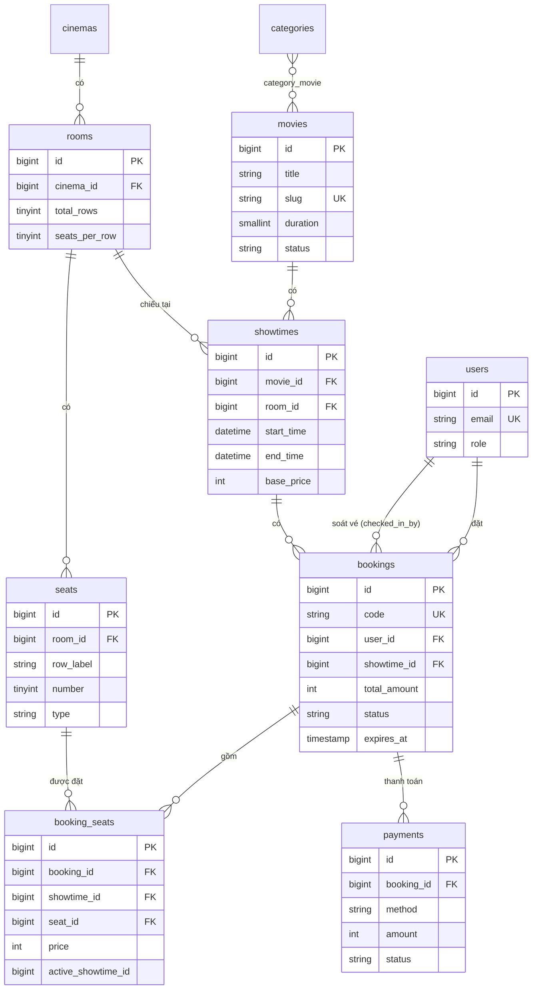

# Thiết kế CSDL — Website đặt vé xem phim (Laravel + Supabase PostgreSQL)

## 1. Danh sách bảng

| # | Bảng | Mục đích | Ghi chú |
|---|------|----------|---------|
| 1 | `users` | Người dùng | Thêm cột `role` (customer/staff/admin), `phone` |
| 2 | `categories` | Thể loại phim | |
| 3 | `movies` | Phim | `status`: coming_soon / now_showing / ended; xóa mềm |
| 4 | `category_movie` | Phim ↔ thể loại (n-n) | Tên theo quy ước Laravel |
| 5 | `cinemas` | Rạp | |
| 6 | `rooms` | Phòng chiếu | `total_rows`, `seats_per_row` để vẽ sơ đồ |
| 7 | `seats` | Ghế | `type`: standard / vip / couple; unique (phòng, hàng, số) |
| 8 | `showtimes` | Suất chiếu | `base_price`, `end_time` để kiểm tra trùng giờ |
| 9 | `bookings` | Đơn đặt vé | `code` = mã vé, `status`, `expires_at` |
| 10 | `booking_seats` | Ghế trong đơn | **Chống đặt trùng ghế** (xem mục 3) |
| 11 | `payments` | Thanh toán | Bản cơ bản dùng `method = mock` hoặc `cash` |

Thay đổi so với đề cương ban đầu:
- **Bỏ bảng `roles`**: chỉ có 3 vai trò cố định nên dùng một cột `users.role` + PHP Enum là đủ, gọn hơn khi viết middleware.
- **`movie_categories` → `category_movie`**: đặt tên theo quy ước để `belongsToMany()` chạy được mà không phải khai báo thêm.
- **`booking_details` → `booking_seats`**: thêm cột `showtime_id` và `active_showtime_id` để chặn trùng ghế ngay ở tầng DB.
- **`promotions`, `reviews`** để sang bản mở rộng.

## 2. Sơ đồ quan hệ (ERD)



## 3. Chống hai người đặt trùng một ghế

Ràng buộc chính nằm ở bảng `booking_seats`:

```
UNIQUE (active_showtime_id, seat_id)
```

- Ghế đang được giữ hoặc đã bán thì `active_showtime_id = showtime_id`.
- Đơn bị hủy hoặc hết hạn thì `active_showtime_id = NULL`. Việc này được model `Booking` tự cập nhật khi đổi `status`.
- PostgreSQL (Supabase) và MySQL đều cho phép nhiều dòng `NULL` trong một UNIQUE index, nên đơn đã hủy vẫn được giữ làm lịch sử, còn ghế thì được mở bán lại.
- Khi hai request cùng chèn một ghế, request đến sau sẽ bị lỗi duplicate key (SQLSTATE 23000). `BookingService` bắt lỗi này và báo cho khách chọn ghế khác.

Logic chính trong `app/Services/BookingService.php` (rút gọn):

```php
DB::transaction(function () use ($user, $showtime, $seatIds) {
    $seats = Seat::where('room_id', $showtime->room_id)
        ->whereIn('id', $seatIds)->where('is_active', true)->get();
    abort_if($seats->count() !== count($seatIds), 422, 'Ghế không hợp lệ');

    $booking = Booking::create([
        'user_id' => $user->id,
        'showtime_id' => $showtime->id,
        'total_amount' => 0,
        'status' => BookingStatus::Pending,
        'expires_at' => now()->addMinutes(10),
    ]);

    $total = 0;
    foreach ($seats as $seat) {
        $price = $showtime->base_price + $seat->type->surcharge();
        $booking->seats()->create([
            'showtime_id' => $showtime->id,
            'active_showtime_id' => $showtime->id,
            'seat_id' => $seat->id,
            'price' => $price,
        ]);
        $total += $price;
    }
    $booking->update(['total_amount' => $total]);
    return $booking;
});
// catch (UniqueConstraintViolationException) => 409 "Ghế vừa có người đặt"
```

Lệnh `bookings:expire` (chạy mỗi phút qua scheduler, đồng thời được gọi mỗi khi mở sơ đồ ghế) chuyển các đơn `pending` đã quá `expires_at` sang `expired`, nhờ đó ghế tự được nhả.

## 4. Vòng đời đơn đặt vé

```
pending ──thanh toán──▶ paid ──nhân viên quét mã──▶ used
   │                      │
   ├──quá 10 phút──▶ expired
   └──khách hủy───▶ cancelled ◀──admin hủy──┘
```

## 5. Cài đặt

Xem `README.md`.
